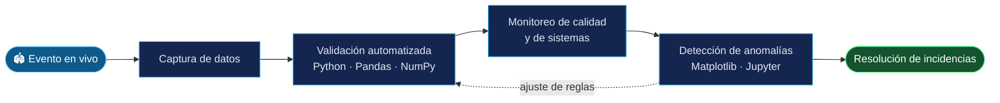

<p align="center">
  
</p>

<p align="center">
  <a href="https://www.linkedin.com/in/juan-andres-marin-cardenas-3302b3272/"></a>
  <a href="mailto:juanandresmarin16@gmail.com"></a>
  
</p>

## 👋 Sobre mí

```python
class Juan:
    nombre      = "Juan Andrés Marín Cárdenas"
    rol         = "Analista de datos · modelado de datos y backend"
    ubicacion   = "Medellín, Colombia"
    estudio     = "Ingeniería en Desarrollo de Software (8.º semestre)"
    trabajo     = "Live Data Analyst @ Genius Sports"
    datos       = ["Python", "Pandas", "NumPy", "Matplotlib", "Jupyter", "SQL"]
    stack       = ["TypeScript", "FastAPI", "NestJS", "PostgreSQL", "Docker"]
    aprendiendo = ["AWS", "Arquitectura limpia", "Ciberseguridad"]

    def buscando(self):
        return "Nuevos retos en análisis de datos y desarrollo backend 🚀"
```

Trabajo con datos en tiempo real y construyo aplicaciones web y APIs con Python y TypeScript. Me importa la calidad del dato y el backend bien hecho: validación, pruebas y seguridad.

---

## 🧭 Trayectoria

<p align="center">
  
</p>

<details>
<summary><b>Ver detalle</b></summary>
<br>

- 📊 **Genius Sports** · Live Data Analyst (2024 – hoy): captura, validación y monitoreo de datos deportivos en vivo para competiciones nacionales e internacionales, con Python (Pandas, NumPy), Matplotlib y Jupyter.
- 🏛️ **VIVA, Empresa de Vivienda de Antioquia** · Desarrollador de software (2025 – 2026): módulos de gestión de usuarios, reportes automatizados y bases de datos con Python y JavaScript.
- 🎓 **Institución Universitaria Pascual Bravo** · Tecnólogo en Desarrollo de Software e Ingeniería en Desarrollo de Software (8.º semestre).
- ☁️ Estudiando AWS Cloud Essentials.

</details>

---

## 📊 Análisis de datos · Live Data Analyst

En **Genius Sports** los datos deportivos se capturan mientras el evento ocurre, así que la calidad se cuida en el momento y no después. Mi trabajo es que lo que se captura sea correcto, completo y consistente, y que los sistemas que lo sostienen sigan funcionando durante toda la competición.



| Qué hago | Con qué |
|---|---|
| Capturar y procesar datos en tiempo real, de competiciones nacionales e internacionales | Python · Pandas · NumPy |
| Validar calidad y consistencia con pipelines y scripts automáticos | Python |
| Detectar anomalías y explorarlas visualmente | Matplotlib · Jupyter Notebooks |
| Modelar y consultar datos relacionales | SQL · MySQL · SQL Server |
| Monitorear sensores, cámaras y redes durante eventos en vivo | Herramientas de monitoreo |
| Resolver incidencias técnicas en entornos de alta disponibilidad | Trabajo con equipos internacionales |

<details>
<summary><b>🧪 Ejemplo de cómo valido datos con Pandas</b> (ilustrativo, no es código de la empresa)</summary>

```python
import pandas as pd

def validar_eventos(df: pd.DataFrame) -> pd.DataFrame:
    """Marca eventos duplicados, incompletos o con valores atípicos."""
    df = df.copy()
    df["duplicado"] = df.duplicated(subset=["id_evento", "marca_tiempo"], keep=False)
    df["incompleto"] = df[["id_evento", "marca_tiempo", "valor"]].isna().any(axis=1)
    z = (df["valor"] - df["valor"].mean()) / df["valor"].std()
    df["anomalia"] = z.abs() > 3          # más de 3 desviaciones estándar
    return df
```

</details>

---

## 🚀 Proyectos destacados

<table>
<tr>
<td width="50%" valign="top">

### 🍔 [Appresso Food](https://github.com/Juan-MarinC/Appresso-Cafe)
Gestión de un restaurante de comida rápida: pedidos por local y domicilio, rutas de entrega sobre un grafo de barrios y despacho priorizado con un heap.

🛡️ **Detección de fraude:** ventana deslizante por usuario y hash **HMAC-SHA256** para verificar la integridad de cada transacción.

✅ API REST completa, logs por petición y dashboard de anomalías.<br>
🧪 83 pruebas unitarias y 31 de extremo a extremo contra MongoDB real.


</td>
<td width="50%" valign="top">

### 🛍️ [Tienda online · Alma Práctica](https://github.com/Juan-MarinC/Alma-Practica)
Tienda de ropa, maquillaje y accesorios para Colombia: catálogo, panel de administración, cuentas de clientas y pagos con **Wompi** (PSE, Nequi, tarjetas).

🏗️ Backend en **NestJS** con arquitectura hexagonal y **PostgreSQL**.<br>
🎨 Frontend en **Next.js + React + Tailwind**.<br>
📦 Entorno reproducible con Docker Compose.


</td>
</tr>
<tr>
<td colspan="2">

### 👾 [Space Invaders en C#](https://github.com/Juan-MarinC/Space-invaders-spaghetti-code-Espa-ol-)
Juego con Windows Forms: jugador, enemigos, velocidad de disparo y de movimiento configurables, dos niveles y menú de inicio. 

</td>
</tr>
</table>

---

## 🛠️ Stack

<table>
<tr>
<th>📊 Datos</th>
<th>⚙️ Backend y web</th>
<th>☁️ Herramientas</th>
</tr>
<tr>
<td align="center" valign="top">
<br><br>

<br>


</td>
<td align="center" valign="top">

</td>
<td align="center" valign="top">

</td>
</tr>
</table>

**Práctica diaria:** análisis de datos con Pandas y NumPy · APIs REST · modelado de bases de datos · Git Flow y Pull Requests · pruebas automatizadas · programación orientada a objetos · seguridad básica de aplicaciones.

---

<p align="center">
  <i>Siempre abierto a aprender y a proyectos con retos interesantes. ¡Hablemos!</i><br><br>
  
</p>
